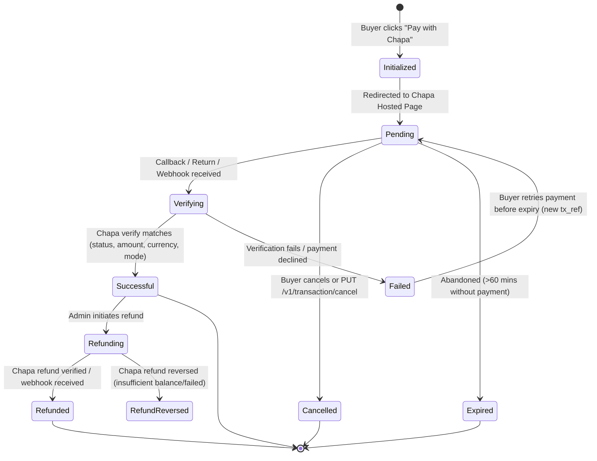

# Chapa Payment Integration Architecture & Runbook

**Project**: ArifDrop (Gumroad fork for Ethiopia)  
**Branch**: `feat/chapa-checkout` (Lane 3)  
**Primary Currency**: ETB (Ethiopian Birr)  
**Status**: Architecture & Design Specification (Part A)

---

## 1. Executive Summary & Audit Report

### 1.1 Existing Chapa Codebase Audit

Prior to this implementation, a preliminary Chapa implementation existed across the codebase with notable architectural gaps:

| Component | Current Implementation | Issues & Vulnerabilities | Target Design |
| :--- | :--- | :--- | :--- |
| **`Chapa::Client`** (`app/services/chapa/client.rb`) | Minimal wrapper around Faraday with basic `initialize_transaction` and `verify_transaction`. | Uses Ruby float division `amount_cents / 100.0` (precision hazard); no refund or verify-refund endpoints; no timeout policy; no retries on safe GETs. | Strict `BigDecimal` santim/birr conversion; explicit POST (no retry) vs GET (safe retry with backoff); full refund endpoints; field truncation & phone formatting. |
| **`Payments::ChapaGateway`** (`app/business/payments/chapa_gateway.rb`) | Static helper returning `Chapa::Client.new`. | Completely disconnected from `ChargeProcessor` inheritance hierarchy and order creation services. | Integrated as a first-class gateway alongside Gumroad processor abstractions. |
| **`OrdersController#create`** (`app/controllers/orders_controller.rb`) | Initiates Chapa transaction inline if `is_chapa_order`. | Re-computes order price from client params; does NOT persist attempts to an audit table; sets `return_url` on the request host (breaks custom domain callbacks). | Recomputes price strictly server-side from product/variant/discount models; persists attempt in `chapa_transactions`; resolves ONE canonical host for return and callback URLs. |
| **`PurchasesController#chapa_callback`** (`app/controllers/purchases_controller.rb`) | Synchronous return handler on `/purchases/:id/chapa_callback`. | If bank payment is still processing when buyer returns, the request fails with 404 or unverified; no polling state; no recovery. | Canonical return URL points to a dedicated Inertia Return Page (`/orders/:order_id/return`) polling `/orders/:order_id/chapa_status`. |
| **`Webhooks::ChapaController`** (`app/controllers/webhooks/chapa_controller.rb`) | Synchronously executes gateway verify and marks purchase successful in request thread. | No idempotency table for raw webhook events (`chapa_webhook_events`); slow HTTP response to Chapa; duplicates finalizer code with callback. | Stores raw payload immediately in `chapa_webhook_events`, returns 200 OK fast, delegates processing to an idempotent Sidekiq worker calling `Chapa::FinalizerService`. |
| **`Purchase::MarkSuccessfulService`** | Marks individual purchases as successful, grants digital access, enqueues receipt emails. | Called directly in multiple places without wrapping multi-item orders in row-locked transactions. | Consolidated behind a single idempotent `Chapa::FinalizerService` with row locking (`order.with_lock` / `purchase.with_lock`). |

### 1.2 Amount Units (Santims vs Birr) at Boundaries

Money denomination represents a critical boundary in payment gateways:

1. **Database & Domain Models**: Gumroad stores all monetary values as integer minor units (`price_cents`, `fee_cents`, `gumroad_fee_cents`, `tax_cents`). For ETB, 1 Birr = 100 Santims. In ArifDrop, 1 minor unit = 1 Santim.
2. **Chapa API Boundary**: Chapa’s API requires amounts in major units (Birr) formatted as a two-decimal-place string (e.g. `100.50` Birr for 10,050 Santims).
3. **Hazard Eliminated**: Previous code used float division `(amount_cents / 100.0)` and `(amount.to_f * 100).round`. Floating-point arithmetic introduces IEEE-754 rounding errors (e.g. `100.00000000000001` or `99.99999999999999`), causing spurious validation failures on fractional amounts.
4. **Resolution**: All conversions are handled strictly via `Chapa::Money` using `BigDecimal`:
   - `Chapa::Money.santims_to_birr_string(10050)` $\rightarrow$ `"100.50"`
   - `Chapa::Money.birr_to_santims("100.50")` $\rightarrow$ `10050`

### 1.3 Storefronts, Subdomains, and Canonical Host Resolution

Gumroad storefronts operate across multiple domains:
- Root application host (e.g. `arifdrop.com`, or in dev lane 3: `localhost:3003`)
- Seller subdomains (e.g. `creator.arifdrop.com`)
- Seller custom domains (e.g. `creatorstore.et`)

**The Problem**: Chapa callbacks and webhooks sent to custom domains often fail due to external DNS, SSL termination, or transient domain misconfigurations. Furthermore, Chapa webhooks configured in the dashboard only target a single URL.

**The Solution**:
- All Chapa transactions are initialized with `callback_url` and `return_url` pointing to **ONE canonical application host** (`UrlService.canonical_host` or `PlatformConfig.domain` respecting `DEV_LANE_PORT`).
- The order records the originating host/referrer in `order.origin_url`.
- Upon successful return and verification on the canonical host, the buyer is redirected back to the originating storefront's receipt or library page.

### 1.4 Product Types & Recurring Billing Gating

Gumroad supports several product types:
1. **Digital & Physical Goods** (One-time payment): Supported via Chapa checkout.
2. **Pay-What-You-Want (PWYW), Discount Codes, Gifts, Tips**: Supported via Chapa checkout.
3. **Rentals** (`Link#rental?`): Supported. Rentals are one-time charges with timed access expiry (e.g. 48 hours); they do not require recurring billing.
4. **Memberships / Subscriptions** (`Link#is_subscription?`): **BLOCKED**. Requires recurring merchant-initiated billing.
5. **Installment Plans** (`Link#allow_installment_plan?`): **BLOCKED**. Requires off-session scheduled charges.
6. **Preorders** (`Link#is_preorder?`): **BLOCKED**. Requires authorization tokenization with capture on release.

**Gating Strategy**:
- Controlled by a single Flipper feature flag: `:recurring_products` (default `false`).
- **Seller UI**: In product creation and edit pages, the membership, installment plan, and preorder toggles are disabled with an informative localized tooltip/badge (`checkout.recurring_unsupported_notice`).
- **Checkout UI**: If a buyer attempts to checkout with a recurring product while the flag is disabled, the checkout displays a localized error (`checkout.recurring_product_blocked`) and prevents initialization.
- **Backend Validation**: `Link` validations and `OrdersController#create` enforce this rule as a server-side invariant.

---

## 2. Payment State Machine & Lifecycle

### 2.1 State Transition Diagram



### 2.2 Concurrency & Idempotency Rules

Finalization can be triggered simultaneously by four distinct pathways:
1. **Buyer Browser Return** (`GET /orders/:order_id/return`)
2. **Server-to-Server Callback** (`POST /webhooks/chapa/callback`)
3. **Chapa Account Webhook** (`POST /webhooks/chapa`)
4. **Background Reconciliation Cron** (`Chapa::ReconciliationJob`)

To guarantee zero race conditions and zero duplicate fulfillment:
- **`Chapa::FinalizerService`** wraps all finalization logic in an explicit database row lock:
  ```ruby
  order.with_lock do
    return if order.successful?
    # verify with gateway
    # reconcile transaction record
    # mark purchases successful
    # credit balances & emit receipts
  end
  ```
- **Webhook Idempotency**: Raw webhook events are recorded in `chapa_webhook_events` with unique `(event_type, event_id)` or SHA256 of raw body. Duplicate webhooks return HTTP 200 immediately without reprocessing.
- **Transaction History**: Every attempt creates a row in `chapa_transactions` with unique `tx_ref`.

---

## 3. Environment Configuration & Security

### 3.1 Environment Variables

| Variable | Description | Required In | Format / Example |
| :--- | :--- | :--- | :--- |
| `CHAPA_SECRET_KEY` | Chapa API secret key for server-to-server calls | Dev, Staging, Prod | Test: `CHASECK_TEST-xxx`<br>Live: `CHASECK-xxx` |
| `CHAPA_PUBLIC_KEY` | Chapa public key (optional for server-only redirect) | Optional | Test: `CHAPUBK_TEST-xxx` |
| `CHAPA_WEBHOOK_SECRET` | Secret hash configured in Chapa Dashboard for webhooks | Staging, Prod | Random alphanumeric string |
| `CHAPA_API_URL` | Base URL for Chapa API | Optional | Default: `https://api.chapa.co/v1` |

### 3.2 Security Constraints & Rules

1. **Key Exposure Prevention**: Secrets are loaded solely from environment variables. Secrets are NEVER printed, logged, or serialized into client-side props.
2. **Boot-Time Guard**:
   - In `production`: The application boot check (`PlatformConfig.validate_production_config!`) raises an exception if `CHAPA_SECRET_KEY` starts with `CHASECK_TEST`.
   - In `development` / `test`: A warning is logged if `CHAPA_SECRET_KEY` starts with `CHASECK-` (live key).
3. **Webhook Signature Verification**:
   - Signature is validated over the **RAW request body** (`request.raw_post`).
   - Constant-time comparison (`Rack::Utils.secure_compare`) prevents timing attacks.
   - Dual-key fallback: verifies against `CHAPA_WEBHOOK_SECRET` first; falls back to `CHAPA_SECRET_KEY`. Accepts either `x-chapa-signature` or `chapa-signature`.
4. **Order Integrity**:
   - Server re-calculates exact prices from products, variants, and offer codes; never accepts prices from frontend payloads.
   - `tx_ref` format: `arifdrop-#{order.external_id}-#{SecureRandom.hex(6)}` (cryptographically unguessable).

---

## 4. Return Page & Polling Experience

### 4.1 Flow Architecture

1. Buyer completes payment on Chapa hosted checkout.
2. Chapa redirects buyer's browser to canonical return URL:
   `https://arifdrop.com/orders/:order_id/return?tx_ref=arifdrop-...`
3. The canonical server renders an Inertia page: `Checkout/ChapaReturn`.
4. The frontend polls `/orders/:order_id/chapa_status` every 2 seconds (with a 90-second timeout):
   - **`success`**: Redirects buyer to receipt/library page on originating domain.
   - **`pending`**: Continues polling with animated spinner and status message.
   - **`failed`**: Renders error message and "Try Again" button (returns to checkout).
   - **`cancelled`**: Renders cancellation notice and option to resume order.
   - **`expired`**: Notifies buyer that session expired; prompts fresh checkout.

---

## 5. Refund Policy & Fee Accounting

### 5.1 Chapa Refund Constraints

- Chapa charges processing fees (e.g. 2.5% – 3.5%) that are **non-refundable**.
- Chapa deducts the full refund amount plus charges from the merchant's available balance.
- If Chapa balance is insufficient, refund calls fail with HTTP 400 (`Insufficient Balance`).

### 5.2 Fee Allocation Model (Standard Marketplace)

When a refund is approved by an ArifDrop admin:
1. **Buyer**: Receives 100% of the refunded amount in ETB.
2. **ArifDrop Platform**: Forgives its 15% platform fee (net platform revenue from sale becomes 0 ETB) and absorbs Chapa's unrefunded gateway fee as an operating expense.
3. **Seller**: Seller balance is debited only for their net earnings (`price - 15% platform fee`).
4. **State Tracking**: `Refund` record is marked `effective` only when Chapa verify returns `refunded`. If status is `initiated` or `processing`, polling/webhook updates the record.

---

## 6. Runbook: Stuck & Discrepant Payments

### 6.1 Identifying Stuck Payments

A transaction is considered "stuck" if:
- Purchase state remains `in_progress` > 10 minutes after buyer claims payment.
- Chapa transaction status is `pending` while funds were deducted from buyer's Telebirr/bank account.

### 6.2 Admin Re-Verify Action

1. Navigate to `/admin/orders/:id`.
2. Inspect the **Chapa Payment Details** card:
   - `tx_ref`: e.g. `arifdrop-ord123-abc456`
   - `Chapa Reference`: e.g. `MERC-REF-xxx`
   - `Mode`: `test` vs `live`
   - `Gateway Charge`: e.g. `35.00 ETB`
3. Click the **"Re-verify Gateway Status"** button.
4. The server executes `Chapa::FinalizerService.new(order).reverify!`:
   - Calls `GET /v1/transaction/verify/:tx_ref`.
   - If verified, transitions purchase to `successful`, sends receipts, and updates ledger.
   - Displays toast with the updated gateway status.

---

## 7. Local Development & Testing Guide

### 7.1 Running in Lane 3

```bash
bin/dev-lane 3
```
- Rails: `http://localhost:3003`
- Vite: `http://localhost:3042`
- Database: `gumroad_development_lane3`

### 7.2 Webhook Testing with Tunnel

```bash
# In a separate terminal, expose port 3003
ngrok http 3003
# Or cloudflared tunnel
cloudflared tunnel --url http://localhost:3003
```
Copy tunnel URL and update Chapa Dashboard:
- Webhook URL: `https://<tunnel-id>.ngrok-free.app/webhooks/chapa`
- Secret Hash: `test_webhook_hash_123`
- Set in `.env`:
  ```bash
  CHAPA_WEBHOOK_SECRET=test_webhook_hash_123
  ```

### 7.3 Chapa Test Data

**Test Mobile Numbers**:
- Telebirr: `0900123456` (Success)
- CBE Birr: `0900112233` (Success)
- Awash Bank: `0900881111` (Success)
- Failed attempt: any number not listed above (e.g. `0911000000`)

**Test Cards**:
- Visa: `4200 0000 0000 0000`, Expiry: `12/34`, CVV: `123`
- Amex: `3700 0000 0000 0000`, Expiry: `12/34`, CVV: `1234`
